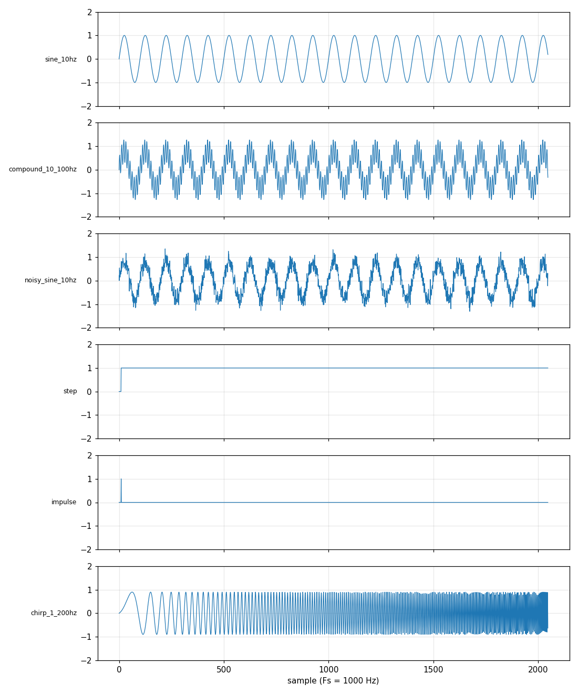

# Test Signals (stimulus generator)

Generates the input signals used to test the DSP blocks (EMA filter, later the cascade and demodulator): sines, compound sines, noisy sines, step, impulse, chirp. Python is the **single source of truth** — it quantizes each signal to Q-format and writes integer files that the VHDL testbenches and the Python golden models both read, so a mismatch downstream is a real DUT bug and not a stimulus difference.

```
gen_signals.py ──► stimulus/<name>.txt ──► VHDL testbench (textio) ──► actual.txt ─┐
                └► stimulus/<name>.hex ──► BRAM/ROM init on the board              ├─► compare
                └► Python golden model (ema_fixed.py) ──► expected.txt ────────────┘
```

## What's here

- `models/gen_signals.py` — building blocks (`sine`, `square`, `chirp`, `step`, `impulse`, `dc`, `gaussian_noise`, `uniform_noise`, `add`, `scale`), quantization (`to_codes`) and file writing (`generate`). Running it directly writes the standard set and `docs/signals.png`.
- `notebooks/generate_signals.ipynb` — the interactive version: change sample rate, length, word format and signal definitions, look at time-domain and spectrum plots, then write files.
- `stimulus/` — the standard set (committed, so testbenches work without running Python).
- `stimulus_custom/` — default output of the notebook (git-ignored).
- `docs/signals.png` — plot of the standard set.

## Standard set

Q2.15, Fs = 1 kHz, 2048 samples each, noise seed 1234.

| File | Content |
|---|---|
| `sine_10hz` | 10 Hz, amplitude 1.0 |
| `compound_10_100hz` | 10 Hz (0.8) + 100 Hz (0.5) |
| `noisy_sine_10hz` | 10 Hz (0.8) + Gaussian noise, sigma 0.2 |
| `step` | 0, then 1.0 from sample 10 |
| `impulse` | single 1.0 sample at index 10 |
| `chirp_1_200hz` | linear sweep 1 → 200 Hz, amplitude 0.9 |



## Regenerating

**Standard set** (after changing a default in `gen_signals.py`):

```
cd models
python3 gen_signals.py
```

**Your own signals / different parameters:** open `notebooks/generate_signals.ipynb`, edit section 1 (parameters) and section 2 (signal definitions), run all cells. Files land in `OUT_DIR` (default `../stimulus_custom`). Point `OUT_DIR` at `../stimulus` only if you really want to overwrite the standard set.

A signal is just a list of floats, so anything you can compute works:

```python
signals = {"my_signal": add(sine(25, 0.7, n=N, fs=FS), gaussian_noise(0.1, n=N, seed=SEED))}
```

## File formats

Both formats hold one sample per line, same order, same values.

| File | Format | Example (Q2.15, +1.0) | Used by |
|---|---|---|---|
| `.txt` | signed decimal integer code | `32768` | VHDL `textio` (`read(line, integer)`), Python models |
| `.hex` | two's-complement hex, `ceil(width/4)` digits | `08000` | Vivado BRAM/ROM init (`$readmemh` / `.mem`), `std_logic_vector` loading |

The integer code is `real_value * 2^FRAC_BITS`. A Qm.f word has `m + f` bits, with `m` counting the sign bit: Q2.15 is 17 bits, range −2.0 … +1.99997, step 2⁻¹⁵.

## Gotchas

- **Keep the peak below `2^(INT_BITS-1)`.** Amplitudes add: 0.8 + 0.5 = 1.3 fits Q2.15, but 1.0 sine + 1.0 noise peaks can exceed 2. Samples beyond the range are saturated (clamped), not wrapped, and the generator prints `(N SATURATED)` so you notice.
- **Noise is reproducible only with a fixed seed.** Same `SEED` and `N` give the same file every run; change `SEED` for a different noise realisation.
- **Frequencies must be below Fs/2.** `sine(600, ...)` at Fs = 1 kHz silently aliases to 400 Hz.
- **Changing Fs changes the filter coefficient.** The stimulus files are just sample sequences with no notion of time; if you replay them at a different rate, recompute `alpha` with `alpha_from_tau` in `dsp02_ema_filter/models/ema_float.py` for the new Ts.
- **A 2048-sample record at 1 kHz lasts ~2 s**, which is slow on a scope. For hardware, replay at a higher rate (and recompute `alpha`).

## Requirements

Python 3 with `numpy` and `matplotlib` (plots), plus Jupyter for the notebook. The generator itself uses only the standard library and `dsp01_fixed_point_basics/models/qformat.py`.
