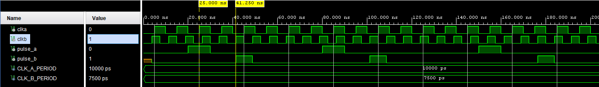
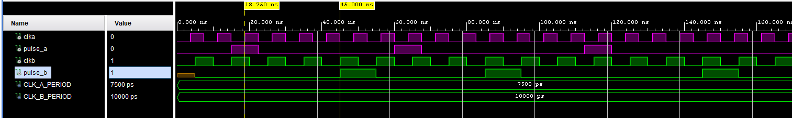
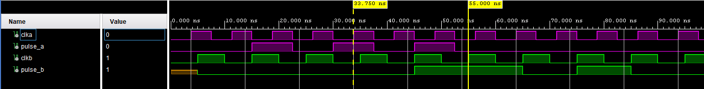
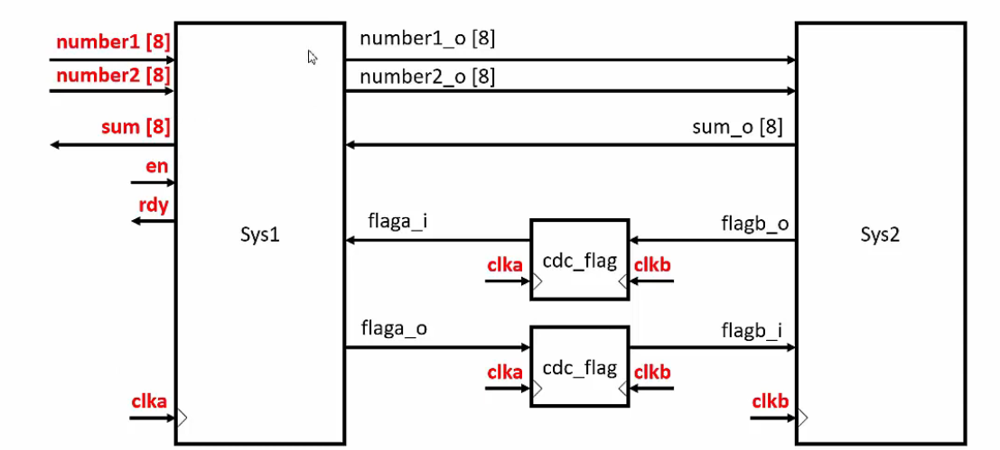
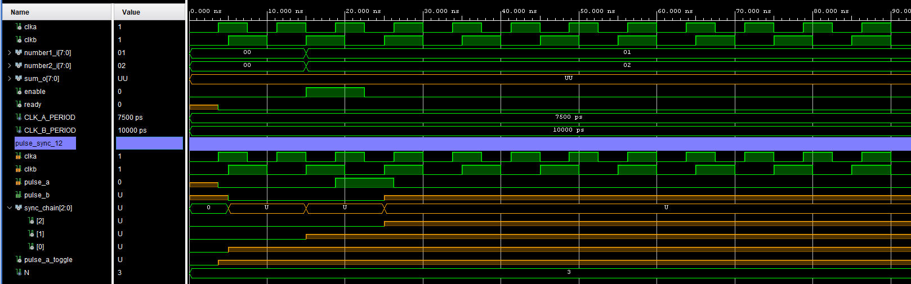
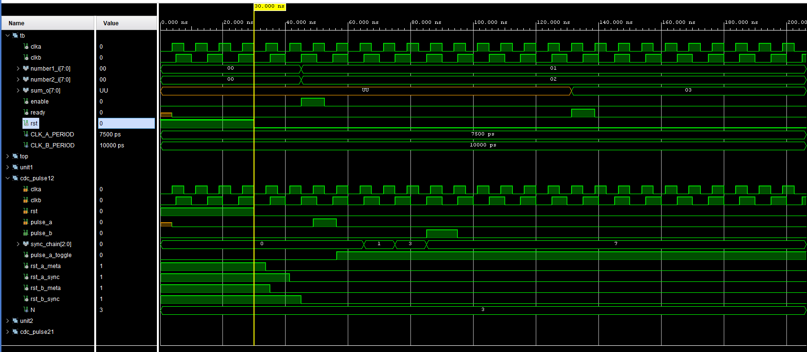

# Clock Domain Crossing

We don't always follow a fully synchronous design methodology, where every FF in the design is driven by the same clock signal.

- Different external interfaces may work with different clock frequencies.
- The clock distribution network can introduce clock skew, meaning the clock signal can arrive later at some FFs than others.
- We don't need to design the whole structure around the fastest unit in the project. Only the block that needs speed runs on the fast clock; the rest can use a slower one. This also reduces power consumption, since dynamic power scales directly with the clock speed of the units in the design.

## Pulse Synchronizer

The following is the hardware needed to implement a pulse synchronizer:


The testbench below shows the crossing in simulation: when `pulse_a` goes high on a rising edge of `clka`, `pulse_b` is produced three rising edges of `clkb` later — clearly visible on the waveform between the yellow markers.


*`pulse_a` asserted in the `clka` domain (10 ns period) produces `pulse_b` three `clkb` cycles later (7.5 ns period), highlighted between the yellow markers.*

That example crosses from a slow clock domain (`clka`) into a fast one (`clkb`). Now let's look at the reverse — fast domain into a slow one — which also works cleanly:


*`pulse_a` asserted in the fast `clka` domain (7.5 ns period) produces `pulse_b` in the slower `clkb` domain (10 ns period).*

Now let's talk about pulse frequency. With a 3-stage synchronizer, if pulses on the fast domain arrive faster than the synchronizer can resolve, they can be missed or merged. Consider sending pulses from the fast domain to the slow domain in quicker succession, like the following stimulus:

```vhdl
  p_STIMULI : process
  begin
    -- Generate a pulse on pulse_a
    wait for CLK_A_PERIOD * 2;
    pulse_a <= '1';
    wait for CLK_A_PERIOD;
    pulse_a <= '0';
    wait for CLK_A_PERIOD;
    pulse_a <= '1';
    wait for CLK_A_PERIOD;
    pulse_a <= '0';
    wait for CLK_A_PERIOD;
    pulse_a <= '1';
    wait for CLK_A_PERIOD;
    pulse_a <= '0';
    wait for CLK_A_PERIOD * 10;

    assert false report "Simulation finished" severity failure;
  end process;

```
We can clearly see that the second pulse of `pulse_a` causes `pulse_b` to stay high for two `clkb` cycles instead of one:



So, we need to be extra careful about the speed differences between domains and the frequency of the sent pulse. Now, let's build an example project using this unit: two systems, `Sys1` and `Sys2`, exchanging a number pair and a sum across independent clock domains, each direction crossed through its own pulse synchronizer.



---

## Gotcha: Uninitialized Signals Can Permanently Poison a Toggle Synchronizer

Building the example above surfaced a nasty simulation-only bug: the composed testbench (`Sys1`/`Sys2` connected through two pulse synchronizers) never finished. `rdy_o` never asserted, so `wait until rdy_o = '1'` blocked forever.

**Root cause:** the `flaga_o`/`flagb_o` (or `pulse_a_o`) output ports on `Sys1`/`Sys2` have no initial value, so they start at `'U'` (unknown) at time 0 in simulation. On the very first clock edge, the synchronizer's toggle register does:

```vhdl
pulse_a_toggle <= pulse_a_toggle xor pulse_a;
```

XOR-ing in that `'U'` poisons `pulse_a_toggle` to `'U'` — and it never clears, since `'U' xor` *anything* is still `'U'` (unlike an AND/OR gate, which can recover from an unknown once a dominating `'0'`/`'1'` comes through). Every stage downstream of the toggle (the sync shift register, the output pulse, the whole handshake) stays `'U'` forever.



**This is simulation-only.** On real hardware, FPGA flip-flops always power up to a defined bitstream-configured state (Xilinx 7-series defaults to `'0'` when no initial value is specified) — there's no such thing as `'U'` in silicon. So this exact hang can never happen on the real FPGA; it only blocks RTL simulation.

**What doesn't fix it:** giving the *outer* connecting signal a default value (`signal pulse_unit1_o : std_logic := '0';`) does **not** help — when a signal is directly driven by another entity's output port, the simulated initial value is governed by that port's own driver, not by the outer declaration.

**What does fix it:** an explicit reset that forces the toggle register and shift chain to a known `'0'` before any real signal crosses — proper reset synchronization.

---

## Reset Synchronization

A reset needs to be **asserted asynchronously** (it must take effect immediately, regardless of the clock, since the whole point is recovering from a bad/unknown state) but **released synchronously** (so the release edge can't land inside a flip-flop's recovery/removal window and itself cause metastability). Releasing an async reset directly, with no synchronization, just trades one CDC problem for another.

The fix applied to `cdc_pulse_sync`: a small 2-flop reset synchronizer per clock domain.

```
rst ──┬──────────────► async set ──► [FF]──►[FF] ──► rst_sync (per domain)
      │                              (clk)  (clk)
      └── asserts both stages immediately, independent of clk
```

Each domain gets its own chain (`rst_a_meta`/`rst_a_sync` for `clka`, `rst_b_meta`/`rst_b_sync` for `clkb`). `rst` sets both stages of a chain to `'1'` the instant it's asserted (no clock edge needed); once released, the `'1'` shifts out over two edges of that domain's own clock, so by the time the synchronized reset actually drops, it's aligned to a clean clock edge in that domain — the release can never violate recovery/removal timing.

The synchronized `rst_a_sync` / `rst_b_sync` then async-reset the real logic (`pulse_a_toggle`, `sync_chain`) to `'0'`. As long as `rst` is held for at least one cycle after the clocks start, both units' `pulse_a_o` outputs will have already resolved to a real `'0'` by the time reset releases — so the toggle register never samples a `'U'`, and the gotcha above can't happen.


*With the reset synchronizer in place, `sum_o` correctly resolves to `03` and `ready` asserts — confirming the fix.*

---

## Two Versions, Kept On Purpose

`src/` has two folders: [`pulse_sync_cdc_v1_no_reset`](src/pulse_sync_cdc_v1_no_reset) and [`pulse_sync_cdc`](src/pulse_sync_cdc). v2 isn't kept as a strict replacement for v1 — the reset "fix" isn't free, and which one you want depends on the design.

This is a real, documented tension, not just a quirk of this project: Xilinx's own guidance (the UltraFast Design Methodology, and app notes like XAPP1024 "Reset Design Techniques for Xilinx FPGAs") actively recommends *minimizing* asynchronous resets. Yes — that's a genuine, widely-cited recommendation, and the reasons show up directly in what we just built:

- Every 7-series/UltraScale slice has **one shared Set/Reset (SR) line** for its flip-flops. An async reset claims that resource; FFs that need different async reset conditions can no longer share a slice, hurting packing and density.
- An async-asserted reset still needs its *release* re-synchronized per clock domain — exactly the 2-flop chain built above — to avoid a recovery/removal violation. So "just add an async reset" is never actually free of synchronizer cost; you've added a new CDC-style problem to solve the old one.
- Many designs don't need a run-time reset at all: Xilinx flip-flops power up to a configurable `INIT` value from the bitstream. **`pulse_sync_cdc_v1_no_reset` leans on exactly that** — on real hardware it starts clean with zero reset logic and zero SR usage. Its only weakness is the simulation-only `'U'`-poisoning gotcha above, which can't happen on the actual chip.
- **`pulse_sync_cdc` (v2)** trades that leanness for a design that simulates cleanly *and* can be genuinely re-reset at run time (a button, an error-recovery condition) — something the power-up-only approach can't do.

So: if the design only ever needs a clean power-up start, v1 is arguably the more idiomatic, resource-light choice on real Xilinx hardware. If you need to recover mid-operation, or you need the testbench to simulate cleanly without hand-holding the `'U'` state, you need v2's explicit reset synchronizer. Neither is strictly better — that's why both are kept side by side instead of one replacing the other.

---

## Why We Need Constraints

If we don't account for this, signals crossing between clock domains can violate setup and hold time requirements.

The tool has no way of knowing that we've already handled a CDC path safely (e.g. with a synchronizer) — we have to tell it explicitly through timing constraints.

`set_max_delay` is a good way to solve this: it bounds the path delay without requiring a full clock-to-clock timing relationship between two asynchronous clocks.

---