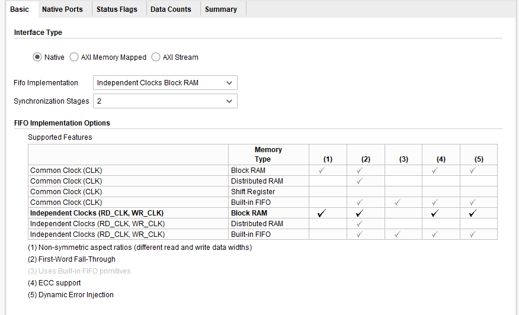
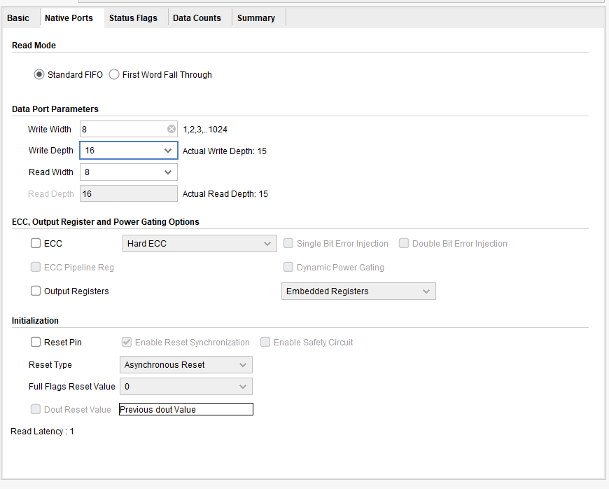
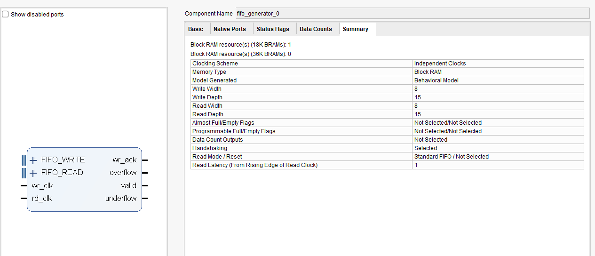
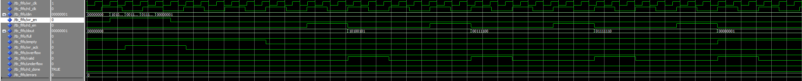
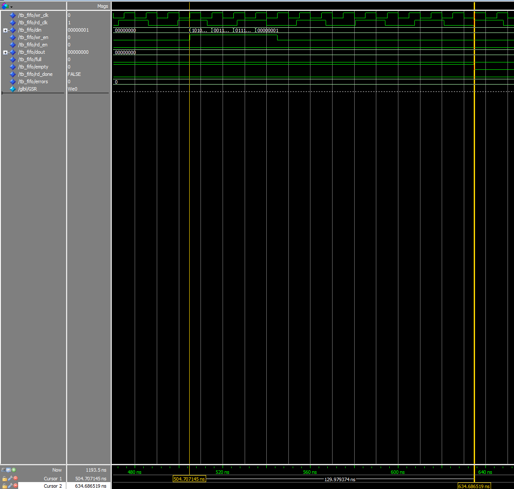
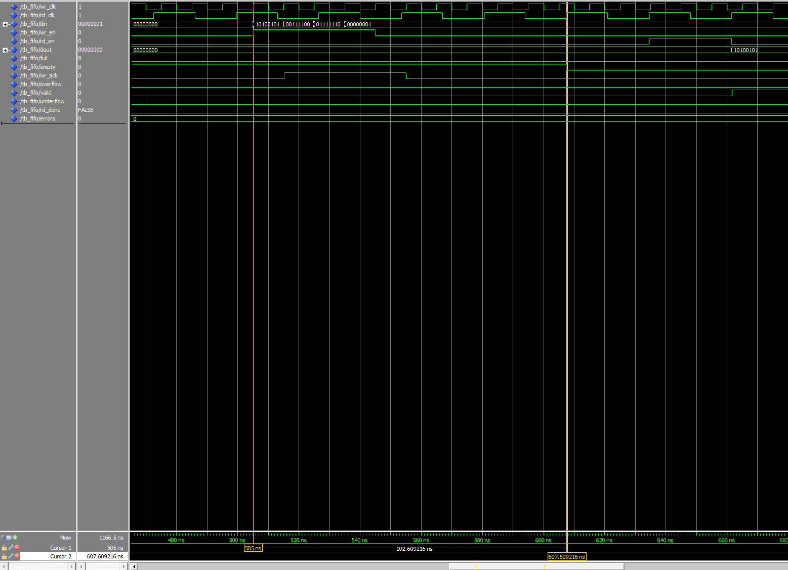
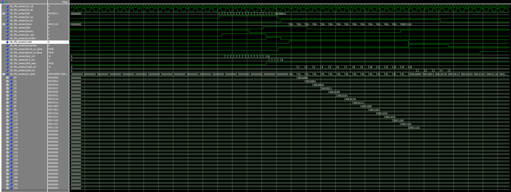

# Asynchronous FIFO — Xilinx FIFO Generator, Smoke Test

[Pulse synchronizers](../vhd15_CDC/README.md) and [N-stage synchronizers](../vhd14_synchronizer/README.md) move one bit, or one event, across a clock boundary. A multi-bit value cannot be moved that way: each bit can settle on a different clock edge, so the receiver can see a value that was never sent. An **asynchronous FIFO** is the standard fix. The write side and the read side each run on their own clock, and only Gray-coded pointers cross between them.

This project uses the **Xilinx FIFO Generator IP** as a plain async FIFO and checks that it can be simulated in ModelSim from a VHDL testbench. 

---

## Source Files

| File               | Description                                                              |
|--------------------|--------------------------------------------------------------------------|
| `src/tb_fifo_smoke1.vhd` | Smoke test 1 — two clocks, writes 4 words, reads them back, checks `empty` |
| `src/tb_fifo_smoke2.vhd` | Smoke test 2 — writes more words than the FIFO holds, then reads more than it accepted, counts `overflow` and `underflow` |

The IP itself (`fifo_generator_0`) is generated in Vivado 2020.1 (FIFO Generator 13.2) for the ZedBoard's Zynq-7020. Its settings are listed below.

---

## The IP

| Setting                    | Value                        |
|----------------------------|------------------------------|
| Interface                  | Native                       |
| Clocking                   | Independent clocks (`wr_clk`, `rd_clk`) |
| Memory type                | Block RAM, 1 × 18K BRAM      |
| Data width                 | 8 bits                       |
| Depth                      | 16 selected, 15 usable (Summary tab) |
| Read mode                  | Standard FIFO (not first-word-fall-through) |
| Read latency               | 1 `rd_clk`                   |
| Synchronizer stages        | 2 (3 in the first run, see [What the Waveform Shows](#what-the-waveform-shows)) |
| Status flags, handshaking  | `wr_ack`, `overflow`, `valid`, `underflow` (all active high), plus `full` and `empty` |
| Reset pin                  | none                         |
| Data counts, almost/programmable flags | none          |
| Simulation model           | Behavioral                   |

The first version of the IP had a depth of 1023, 3 synchronizer stages and no handshaking flags. It was regenerated to measure the effect of the stage count and to expose the overflow and underflow flags.

Basic tab: independent clocks with block RAM, 2 synchronization stages.



Native Ports tab: standard FIFO, 8-bit data, depth 16 (15 usable), no reset pin, read latency 1.



Summary tab:



<!-- IMAGE: docs/ip_status_flags.png — Status Flags tab with wr_ack, overflow, valid, underflow ticked -->


Ports of the generated wrapper:

| Port      | Dir | Width | Clock    | Description          |
|-----------|-----|-------|----------|----------------------|
| `wr_clk`  | in  | 1     | —        | Write clock          |
| `rd_clk`  | in  | 1     | —        | Read clock           |
| `din`     | in  | 8     | `wr_clk` | Write data           |
| `wr_en`   | in  | 1     | `wr_clk` | Write enable         |
| `rd_en`   | in  | 1     | `rd_clk` | Read enable          |
| `dout`    | out | 8     | `rd_clk` | Read data            |
| `full`    | out | 1     | `wr_clk` | FIFO is full         |
| `empty`   | out | 1     | `rd_clk` | FIFO is empty        |
| `wr_ack`  | out | 1     | `wr_clk` | A write was accepted |
| `overflow`| out | 1     | `wr_clk` | `wr_en` while full, the write was rejected |
| `valid`   | out | 1     | `rd_clk` | `dout` holds valid data |
| `underflow`| out | 1    | `rd_clk` | `rd_en` while empty  |

---

## Smoke Test 1 (`tb_fifo_smoke1.vhd`)

The question this answers: can ModelSim load the Xilinx FIFO model and run it from a VHDL testbench? The testbench is deliberately small and does not use UVVM.

* **Clocks**: `wr_clk` has a 10 ns period (100 MHz) and `rd_clk` has 27 ns (about 37 MHz). The periods are not related, so this is a real clock crossing.
* **Write side** (`process_write`): waits 50 `wr_clk` edges, because the IP has no reset pin and the model needs time for its internal power-on reset. It then checks `full = '0'` and writes four words back to back, one per clock: `A5`, `3C`, `7E`, `01`. Each signal is assigned right after a clock edge.
* **Read side** (`process_read`): waits for an `rd_clk` edge with `empty = '0'`, pulses `rd_en` for one clock, and samples `dout` one `rd_clk` later (standard FIFO, read latency 1). It compares each word with the expected one. After the fourth read it waits five `rd_clk` edges and checks that `empty` is high again.
* **Main process**: has a 20 µs watchdog, so a stuck FIFO fails with a message instead of running forever. It prints `SMOKE TEST PASSED` or `FAILED`, then stops the simulation.
* The four handshaking flags are connected but not checked by the smoke test. They are only visible in the waveform.

### Running it

The simulation is run from Vivado with ModelSim as the simulator. Vivado compiles the IP model and starts ModelSim with the library mappings (`-L fifo_generator_v13_2_5 ...`). The testbench is VHDL and the FIFO model is the **Verilog** behavioral model (`fifo_generator_vlog_beh`), so the ModelSim used here handles mixed VHDL and Verilog.

### Result

Final IP (2 synchronizer stages, handshaking flags on):

```
# ** Note: read 0 OK: 165
#    Time: 688500 ps
# ** Note: read 1 OK: 60
#    Time: 769500 ps
# ** Note: read 2 OK: 126
#    Time: 850500 ps
# ** Note: read 3 OK: 1
#    Time: 931500 ps
# ** Note: SMOKE TEST PASSED
#    Time: 1166500 ps
# ** Failure: SIM DONE
```

The values are `A5`, `3C`, `7E`, `01` in decimal, in the order they were written. `SIM DONE` is the testbench's own `assert false ... severity failure`, used to stop the run.

The first run, with the 3-stage IP and no flags, passed the same way. Every time is 27 ns later (the reads at 715.5, 796.5, 877.5 and 958.5 ns, and `SMOKE TEST PASSED` at 1193.5 ns), because `empty` falls one `rd_clk` later with the extra stage and everything after it shifts by the same amount.

The full run of the final IP, with `rd_done` TRUE, `errors` 0 and `empty` high again after the fourth read. `wr_ack` is high for the four writes, and `valid` pulses once per read, together with each `dout` word:



---

## What the Waveform Shows

* **Read latency 1**: `dout` shows the word one `rd_clk` after the edge that sampled `rd_en`, as the Summary tab says.
* **`empty` falls late.** The first word is written at 515 ns (the `wr_clk` edge that samples `wr_en`). `empty` only falls later, always exactly on a `rd_clk` rising edge. The write pointer first has to pass through the synchronizer flops on the read clock, and the flag logic adds more. The flag is delayed on purpose: it is safe, because the FIFO can report "empty" a little too long but never "not empty" too early.
* **The delay follows the number of synchronizer stages.** Same testbench, same clocks, only the stage count changed:

  | Synchronizer stages | `empty` falls at (measured) | After the first write (515 ns) | `rd_clk` edge after the write |
  |---------------------|-----------------------------|--------------------------------|-------------------------------|
  | 3                   | 634.7 ns                    | about 119.5 ns                 | 5th                           |
  | 2                   | 607.6 ns                    | about 92.5 ns                  | 4th                           |

  Removing one stage moved the fall earlier by 27 ns, exactly one `rd_clk`. I predicted 607.5 ns for 2 stages before running it, and the measurement matched. With two data points the rule is: `empty` falls on the (stages + 2)-th `rd_clk` edge after the write. The 4-stage case was not run.

  3 stages (cursors at `wr_en` rising, 504.7 ns, and `empty` falling, 634.7 ns, 130 ns apart):

  

  2 stages (cursors at 505 ns and 607.6 ns, 102.6 ns apart):

  

* **Handshaking flags.** In the 2-stage run, `wr_ack` is high for four `wr_clk` periods, one for each accepted write. `valid` goes high together with the first `dout` word after the read. `overflow` and `underflow` stay low, as expected for this traffic.
* **Model warning.** On start-up the model prints that behavioral models for independent clock FIFOs do not model synchronization delays. A delay that matches the synchronizer stages is visible anyway, so I treat these numbers as what this model does, not as exact hardware timing. A post-implementation timing simulation would be the place to check real flag latency.
* **Power-on.** I waited 50 `wr_clk` edges before the first write. The minimum wait was not measured.

---

## Smoke Test 2: Overflow and Underflow (`tb_fifo_smoke2.vhd`)

Smoke test 1 only ever writes four words into a FIFO that holds 15. This test misuses the FIFO on purpose, to see what the IP does and what its flags report. It uses the same clocks (10 ns and 27 ns), the same 50-clock power-on wait, and the same IP.

* **Overflow**: 20 words (`10` to `23` in hex) are written back to back, one per `wr_clk`, with no reads. The FIFO holds 15.
* **Underflow**: once the writes are done and `empty` falls, `rd_en` is held high for 20 consecutive `rd_clk` periods. Fewer than 20 words are in the FIFO.
* **Monitors**: two clocked processes count `wr_ack`, `overflow`, `valid` and `underflow` pulses, note whether `full` went high, and record every word seen with `valid = '1'`.
* **Check**: the main process prints one summary line with the counts, then compares them with the predictions below and prints `SMOKE TEST 2 PASSED` or `FAILED`.

Predictions, written before the first run. They are guesses about the IP, not its documented behavior:

| Quantity                           | Expected                                   | Observed |
|------------------------------------|--------------------------------------------|----------|
| Accepted writes (`wr_ack` pulses)  | 15                                         | 15       |
| `overflow` pulses                  | 5 (writes 16 to 20)                        | 5        |
| `full`                             | goes high                                  | yes      |
| Words read with `valid` high       | 15                                         | 15       |
| `underflow` pulses                 | 5 (reads 16 to 20)                         | 5        |
| Words that come out                | `10` to `1E`, the first 15, in order       | `10` to `1E`, in order |
| `empty` at the end                 | high                                       | high     |

### Result

```
# ** Note: accepted writes (wr_ack) = 15, overflow = 5, valid reads = 15, underflow = 5, full seen = true
#    Time: 1490500 ps
# ** Note: SMOKE TEST 2 PASSED
#    Time: 1490500 ps
# ** Failure: SIM DONE
```



* **Writes.** `wr_ack` counted 15 accepted writes and `overflow` counted the other 5. `full` went high. The five rejected words (`1F` to `23`) never appear on the read side.
* **The FIFO was not damaged by the overflow.** The 15 words that were read out are `10` to `1E`, the first 15 written, in order (the recorded `rx_data(0)` to `rx_data(14)`). Entries 15 to 31 stay at zero.
* **Reads.** `valid` pulsed 15 times, once per word. The remaining 5 reads while `empty` was high each produced an `underflow` pulse and no `valid`.
* **`dout` after the last word.** In the waveform `dout` stays at the last word, `1E`, during the underflow reads, so `valid` is what marks a real word. The testbench does not check `dout` on underflow reads.
* All of this is with the behavioral model. It says what the IP is meant to do, not that real hardware flag timing matches.

---

## Not Covered Yet

* Reset behavior. The IP has no reset pin, so this would need another regeneration with the reset pin enabled.
* Different clock ratios (write faster than read, and the reverse) and random traffic. Both smoke tests use one fixed pair of clocks.
* A UVVM testbench that automates both smoke tests and adds checks for the `empty` and `full` latency.
* A real use of the FIFO between two clock domains, for example a decimated ADC stream into a UART.

---

## References

1. [Mehmet Burak Aykenar – High-Speed UART Transceiver with FIFO-based CDC](https://www.mehmetburakaykenar.com/clock-domain-crossing-cdc-using-fifos-high-speed-uart-transciever-example/140/)
2. Xilinx *FIFO Generator v13.2 Product Guide* (PG057)

---
⬅️ [MAIN PAGE](../README.md) | ⬅️ [Clock Domain Crossing — Pulse Synchronizer](../vhd15_CDC/README.md)
