# ModelSim Setup with Vivado

I wanted to start using [UVVM](https://github.com/UVVM/UVVM_Light) for my testbenches, but the Vivado simulator doesn't play well with it. UVVM leans heavily on VHDL-2008, and XSim's support for that is still patchy. So I set up ModelSim as the simulator for my Vivado projects. These are the steps I followed and the gotchas I hit along the way.

---

## Step 1: Install ModelSim

Most ModelSim versions should work. I went with **ModelSim-Intel FPGA Starter Edition 19.1** because that's what the tutorial I followed used (see references). It's free, it comes from Intel's download page, and you don't need Quartus to install it.

19.1 is also a safe pick for UVVM. The tutorial mentions it's the version UVVM was tested against, and some later releases had issues.

My install ended up in `C:/intelFPGA/19.1/modelsim_ase/win32aloem`. You'll need this path later.

---

## Step 2: Switch Vivado to ModelSim and Compile the Xilinx Libraries

In Vivado, go to **Tools → Settings → Simulation → Target simulator → ModelSim Simulator**.

A pop-up tells you that ModelSim needs the Xilinx simulation libraries to be pre-compiled first:

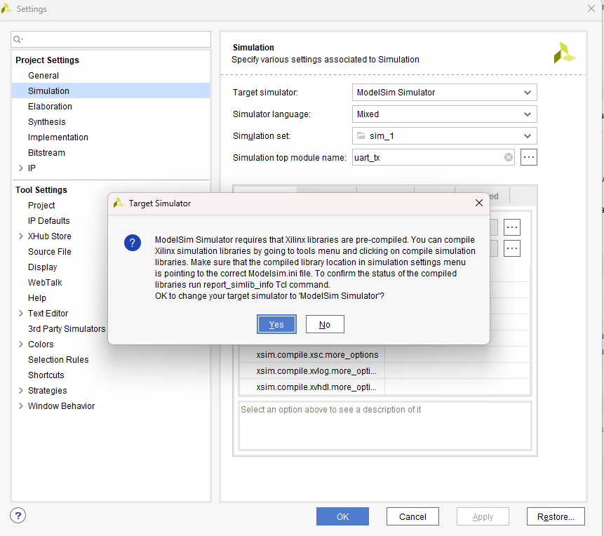

While you're on this page, set `modelsim.compile.vhdl_syntax` to **2008** in the **Compilation** tab. UVVM needs it.

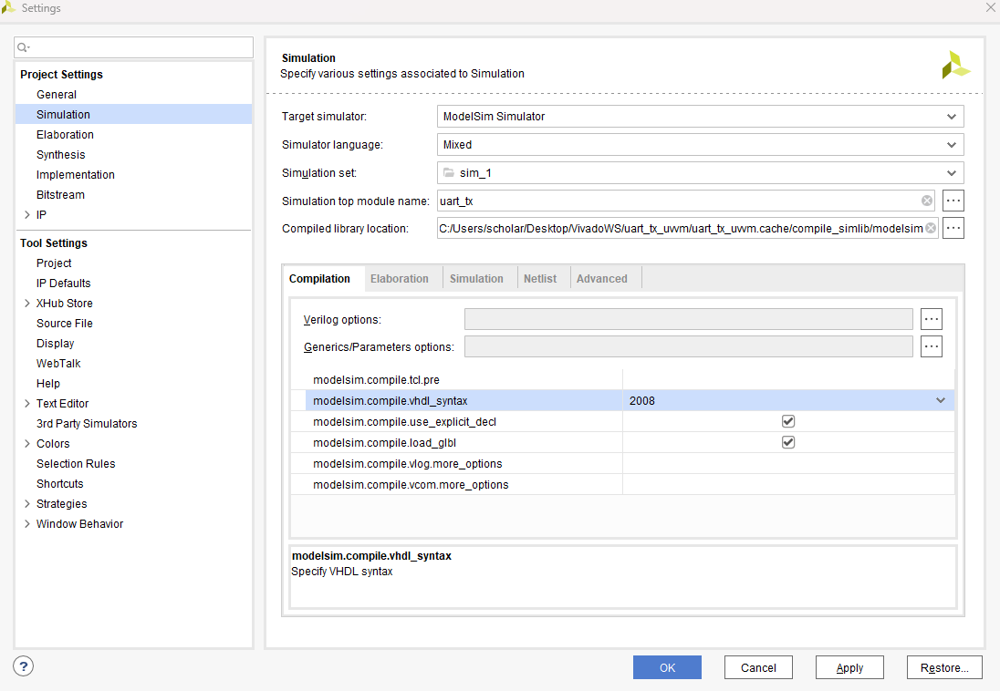

Next, open **Tools → Compile Simulation Libraries**:

* **Family:** only tick the families you actually use. I picked Artix-7, Kintex-7 and Zynq-7000. Compiling everything takes much longer and eats a lot of disk space.
* **Compiled library location:** point this to a folder you created yourself (mine is `C:/Verification/xilinx_compiled`). Don't leave it inside a single project's `.cache` folder, or you'll end up recompiling for every project.
* **Simulator executable path:** the ModelSim install path from Step 1.

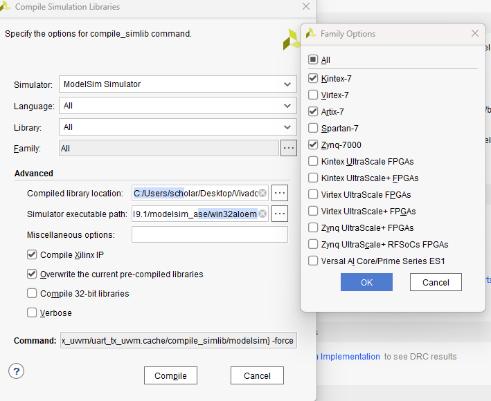

Then hit **Compile** and go grab a coffee. It took around 10–20 minutes for me.

---

## Step 3: Make It Stick for New Projects

At this point **Run Simulation** already opens ModelSim for the current project. But when I created a new project, Vivado didn't know where the compiled libraries were. As the note at the bottom of this page says, the default path is only picked up if you set it under **Tools → Settings → 3rd Party Simulators**:

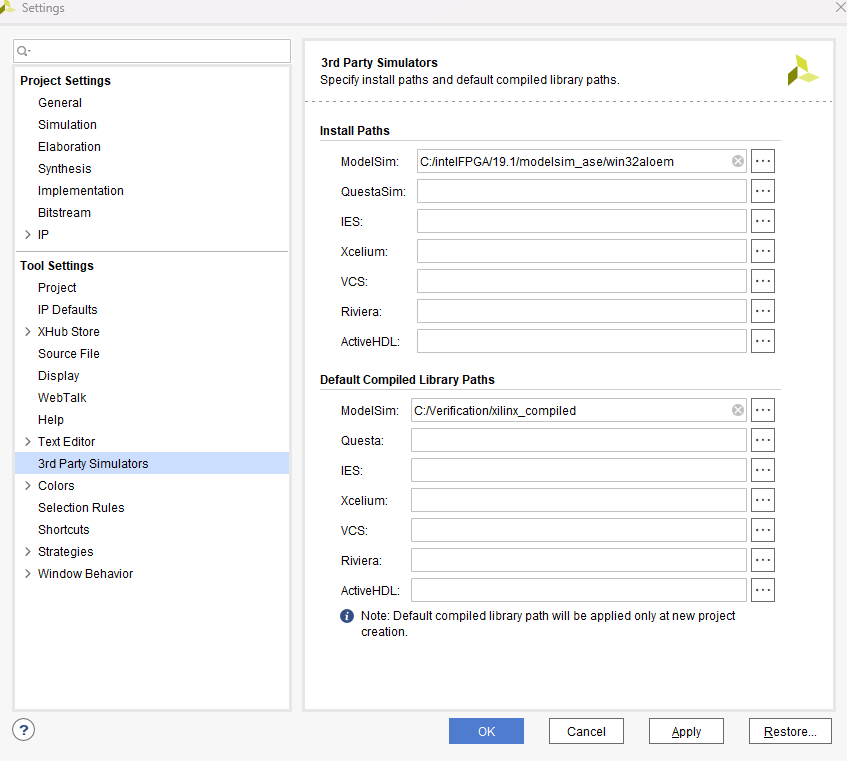

Fill in both the ModelSim install path and the default compiled library path. After that, any new project that selects ModelSim gets the library location filled in automatically, and it won't ask you to compile again.

One catch: the VHDL syntax setting is **not** carried over. A new project starts at `93` again:

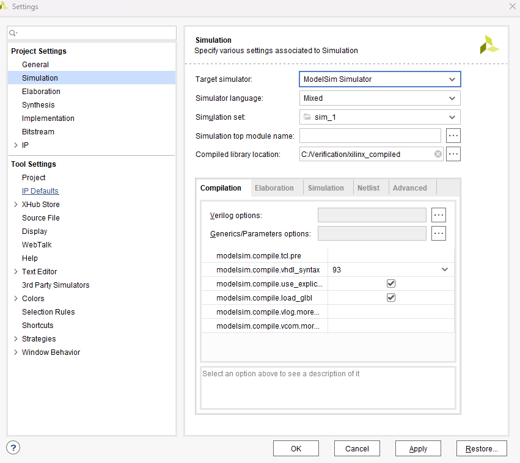

So switch it to `2008` every time:

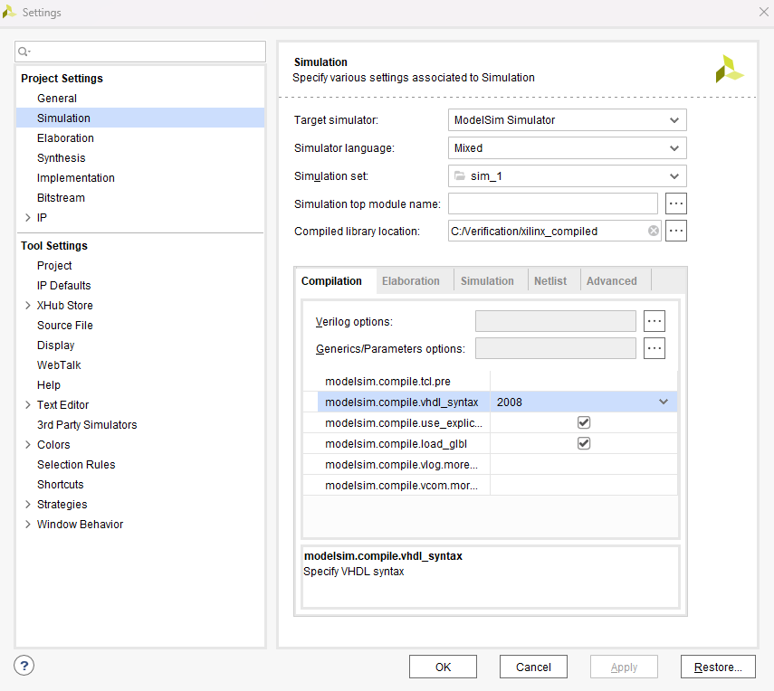

For projects that existed before you set the default path, you'll have to browse to the compiled library location yourself.

---

## Step 4: Set Up UVVM

The UVVM developers suggest starting with **UVVM Light**, which bundles the `util` package and the BFMs into a single library:

https://github.com/UVVM/UVVM_Light

To compile it, I opened ModelSim and ran this in its console, as described on the UVVM Light GitHub page. The two arguments are the UVVM source folder and the output folder:

```tcl
cd C:/Verification/UVVM_Light-master/script
do ../script/compile.do C:/Verification/UVVM_Light-master C:/Verification/uvvm_modelsim/uvvm_compiled
```

When it finishes, the destination folder has a compiled `uvvm_util` library:

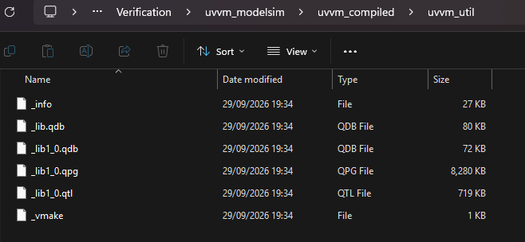

Now ModelSim needs to know about this library. That means adding it to `modelsim.ini` in the ModelSim install folder, and this is where Windows gets in the way: the file is protected and won't let you save it. Two things fixed it for me.

1. **Properties → Security → Edit:** give your user **Full control**.

   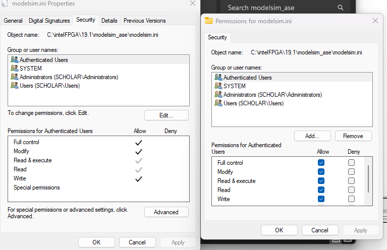

2. **Properties → General:** untick **Read-only**.

   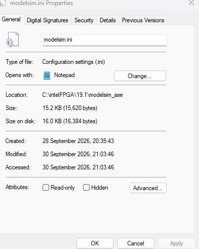

Then add the library under the VHDL section, in the form `name = path`:

```ini
; uvvm libraries I added
uvvm_util = C:\Verification\uvvm_modelsim\uvvm_compiled\uvvm_util
```

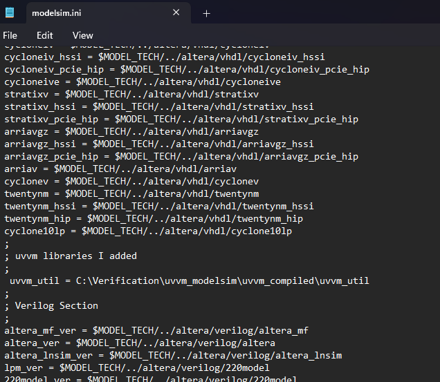

Next time you open ModelSim, `uvvm_util` shows up in the Library panel:

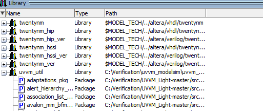

---

## Gotchas

A quick recap of the things that tripped me up:

* **XSim + UVVM don't get along.** That's the whole reason I set this up. Use ModelSim (or Questa, Riviera, GHDL…) for UVVM.
* **Compile the Xilinx libraries into a folder you own.** Compiling into the ModelSim install folder can fail on permissions, and compiling into a project's `.cache` folder ties the libraries to that one project.
* **Only compile the families you need.** All of them together take a long time and several GB of disk.
* **Set the default library path in *3rd Party Simulators*.** Otherwise every new project asks you to compile again. It only applies to projects created *after* you set it.
* **VHDL syntax resets to 93 on new projects.** Remember to switch it to 2008.
* **`modelsim.ini` is read-only by default.** Fix the permissions and untick Read-only before editing it.

---

## References

1. [An Introductory ModelSim Tutorial for Vivado/Xilinx Users](https://www.mehmetburakaykenar.com/an-introductory-modelsim-tutorial-for-vivado-xilinx-users/116/): Mehmet Burak Aykenar
2. [A UVVM Example: UART Transmitter Testbench Simulation on ModelSim](https://www.mehmetburakaykenar.com/a-uvvm-example-uart-transmitter-testbench-simulation-on-modelsim/128/): Mehmet Burak Aykenar
3. [UVVM Light on GitHub](https://github.com/UVVM/UVVM_Light)

---
