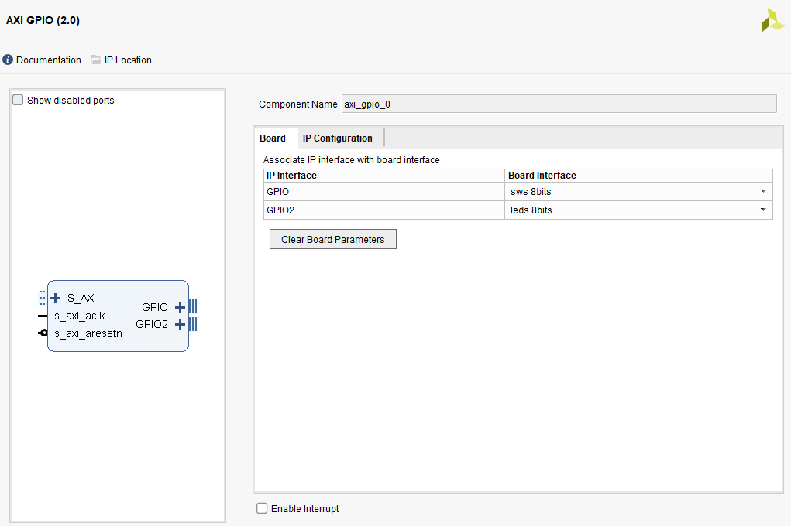
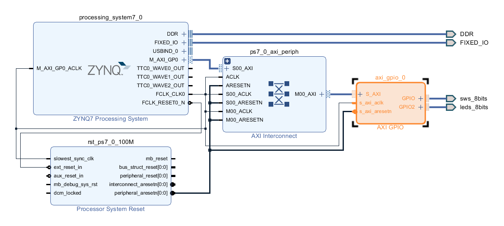
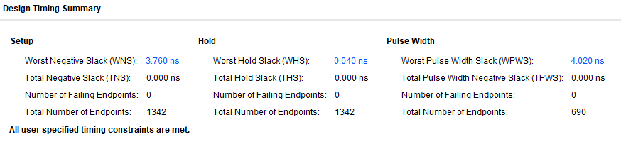
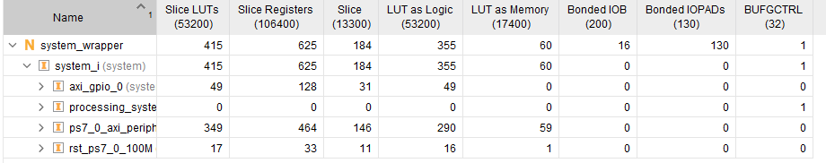
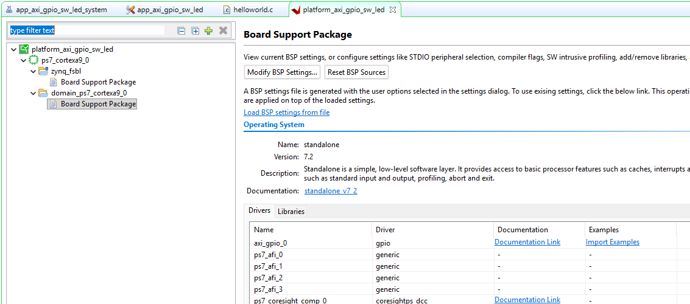
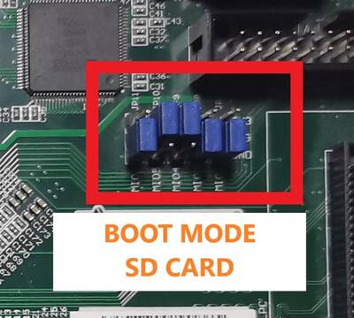
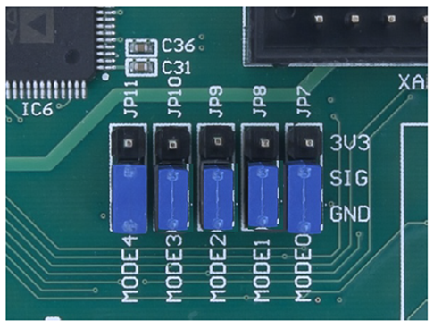
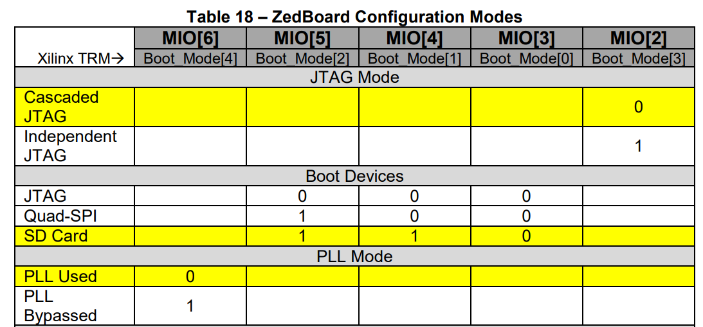

# ZYNQ AXI GPIO – Switch to LED Project

A walkthrough of building a simple AXI GPIO design on the ZedBoard: reading the onboard switches and mirroring their state on the LEDs, plus the boot-mode and UART gotchas encountered while bringing the board up over JTAG.

## 1. Vivado Block Design

### 1.1 Add the Zynq PS and AXI GPIO IP

Add the Zynq7 Processing System and an AXI GPIO block to the block design, then configure the AXI GPIO's **Board** tab to associate `GPIO` with the switches and `GPIO2` with the LEDs.



### 1.2 Run Block/Connection Automation

Run **Run Block Automation** and **Run Connection Automation**, then regenerate the layout. This wires up the AXI interconnect and reset network automatically.



## 2. Synthesis, Implementation, and Bitstream

Create the HDL wrapper and generate the bitstream, then open the implemented design to check timing and resource usage.





All timing constraints were met, with no failing endpoints on setup, hold, or pulse width.

## 3. Export Hardware and Launch Vitis

Export hardware with **Include Bitstream**, then launch the Vitis IDE. Create a new application project and a new platform from the exported `.xsa`.

Vitis auto-generates example programs for the IP in the design — the GPIO driver examples were a useful starting point for reading the switches and driving the LEDs, plus using the PS UART for console output.



## 4. Application Code

```c
#include <stdio.h>
#include "platform.h"
#include "xparameters.h"
#include "xgpio.h"
#include "xil_printf.h"

#define SW_CHANNEL  1
#define LED_CHANNEL 2

XGpio Gpio; /* The Instance of the GPIO Driver */

int main()
{
    int Status;
    u32 sw_values;

    init_platform();
    print("Hello AXI GPIO with SW LED Application\n\r");
    cleanup_platform();

    /* Initialize the GPIO driver */
    Status = XGpio_Initialize(&Gpio, XPAR_GPIO_0_DEVICE_ID);
    if (Status != XST_SUCCESS) {
        xil_printf("Gpio Initialization Failed\r\n");
        return XST_FAILURE;
    }

    XGpio_SetDataDirection(&Gpio, SW_CHANNEL, 0x00);
    XGpio_SetDataDirection(&Gpio, LED_CHANNEL, 0xFF);

    while (1) {
        sw_values = XGpio_DiscreteRead(&Gpio, SW_CHANNEL);

        /* Set the LEDs to the switch values */
        XGpio_DiscreteWrite(&Gpio, LED_CHANNEL, sw_values);
    }
}
```

## 5. Running on Hardware

In the Vitis Assistant window, click **Build**, then **Debug** → **Launch on Hardware**.

## 6. ZedBoard Bring-Up: Boot Mode Jumpers

### Out of the box: SD card boot

Fresh out of the box, the ZedBoard's jumper configuration is set to boot Linux from the SD card.



### Switching to JTAG boot mode

To run a Vitis application via JTAG instead, the boot mode jumpers (JP7–JP11, labeled MODE0–MODE4) need to be moved to the **GND** position — all five set to GND selects JTAG boot mode.



### Reference: ZedBoard Configuration Modes

Per the ZedBoard user guide's configuration table, this confirms the JTAG and SD Card boot mode encodings on MIO[6:2].



## 7. Gotchas

**The PROG port is JTAG-only.** ZedBoard's "PROG" micro-USB port gives programming/debug access but does not carry the UART — no COM port will ever appear from that cable alone.

**A second cable is needed for the console.** The UART micro-USB port (usually labeled UART or PS-UART, next to PROG) carries the USB-to-serial bridge chip that creates the COMx device in Windows (or `/dev/ttyUSBx` on Linux). Both cables need to be connected:

- **PROG port** → JTAG, used by Vitis to download/debug the application
- **UART port** → COM port, used to see console output (`printf`, `xil_printf`, etc.)

**Zynq has two independent UART paths**, which isn't obvious until it trips you up:

1. **PS UART (hardwired)** — Part of the Processing System, free to use once enabled and routed to MIO pins. Vivado's Zynq block automatically routes UART to the ZedBoard's onboard USB-UART bridge when using the standard board preset. No AXI UART IP needed — this is almost certainly what's wanted for `printf`/`xil_printf` console output.
2. **AXI UART Lite (soft IP in PL)** — A separate peripheral added manually to the block design for a *second*, independent UART, typically routed to different physical pins (e.g. a PMOD), not the onboard USB-UART.

**Bottom line:** to see `printf` output over the USB-UART cable, AXI UART Lite is not needed — just the PS7 UART, enabled and routed correctly in the Zynq PS configuration.