# Custom AXI4-Lite IP: Switches → LEDs

This walkthrough packages a custom AXI4-Lite peripheral in Vivado, wires it to
board switches and LEDs, and drives it from a bare-metal application in Vitis.
The peripheral exposes 4 registers over AXI4-Lite; the design only uses two of
them: `reg0` (read-only, switch values) and `reg1[7:0]` (write, LED values).

**Source files:**
- [src/myAXI4lite_swled_v1_0_S00_AXI.vhd](src/myAXI4lite_swled_v1_0_S00_AXI.vhd) — AXI4-Lite slave logic (register read/write, reg0/reg1 wiring)
- [src/myAXI4lite_swled_v1_0.vhd](src/myAXI4lite_swled_v1_0.vhd) — top-level wrapper adding `sw_i`/`led_o` ports
- [src/helloworld.c](src/helloworld.c) — Vitis application
- [src/tb_axilite.vhd](src/tb_axilite.vhd) — UVVM smoke test (one read, one write)
- [src/tb_axilite_regs.vhd](src/tb_axilite_regs.vhd) — UVVM register-level testbench (reset values, read-only register, address decode, walking ones, partial writes, a deliberate failure)

Simulation and testbenches are described in [Verification with UVVM](#12-verification-with-uvvm).

## 1. Create the IP

**Tools → Create and Package New IP**


Choose **Create a new AXI4 Peripheral**. Give it a name and a location — pick
a dedicated folder to hold your custom IPs, since Vivado will later point at
this folder as an IP repository. A description is optional.

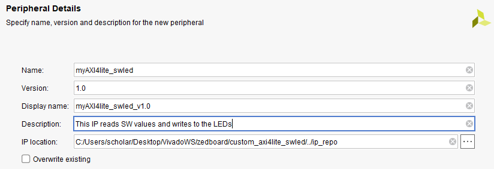

## 2. Configure the interface

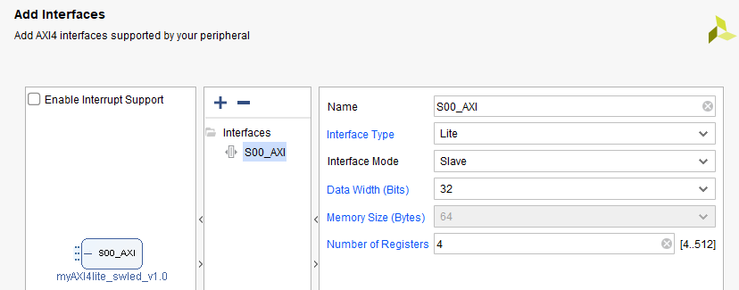

- **Interface Type:** Lite
- **Interface Mode:** Slave
- **Number of Registers:** 4 (the minimum)

Interface type matters here:
- **Lite** — simple memory-mapped registers, no burst support. Used for this design.
- **Full** — backed by a BRAM, supports burst transactions.
- **Stream** — no addressing at all; data flows as a continuous stream (AXI4-Stream).

Click **Create Peripheral**, then check **Edit IP** on the finish screen so
the generated IP project opens immediately for editing.

## 3. Edit the IP source

The IP project opens with the generated AXI4-Lite slave template.


Only I/O ports were added to the top-level entity; the register read/write
logic already comes from the Xilinx template.

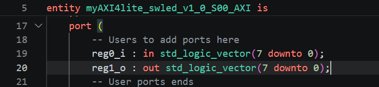

Since `reg0` is used to read switch values, the PS must never write to it.
All write logic touching `slv_reg0` is commented out in the generated write
process (see the `when b"00"` case and reset branch in
[myAXI4lite_swled_v1_0_S00_AXI.vhd](src/myAXI4lite_swled_v1_0_S00_AXI.vhd)),
so `reg0` is effectively read-only from the AXI side.

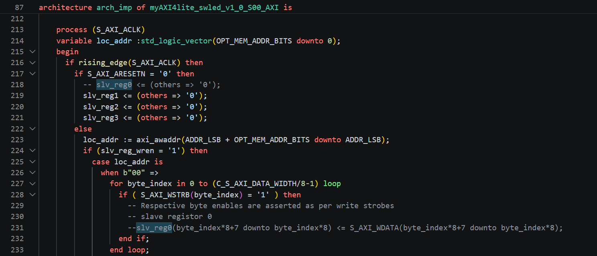

The functional wiring, added at the end of the same file's architecture body:
- `slv_reg0` ← switch inputs (driven combinationally from `reg0_i`, not AXI writes)
- `slv_reg1[7:0]` → LED outputs (`reg1_o`, written by the PS over AXI)

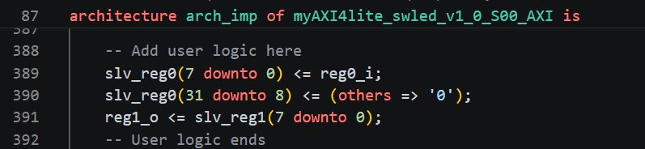

## 4. Update the wrapper

The wrapper file, [myAXI4lite_swled_v1_0.vhd](src/myAXI4lite_swled_v1_0.vhd),
only adds the new I/O ports (`sw_i`, `led_o`) and connects them through to the
underlying AXI4-Lite subentity — its component instantiation/generic map has
to be updated to match.

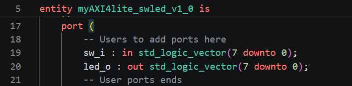

## 5. Synthesize and package

Run **Synthesis** first to catch structural errors before packaging — a
malformed interface definition is much easier to debug at this stage than
after the IP is packaged and instantiated in a block design. Once synthesis
is clean, click **Package IP**.

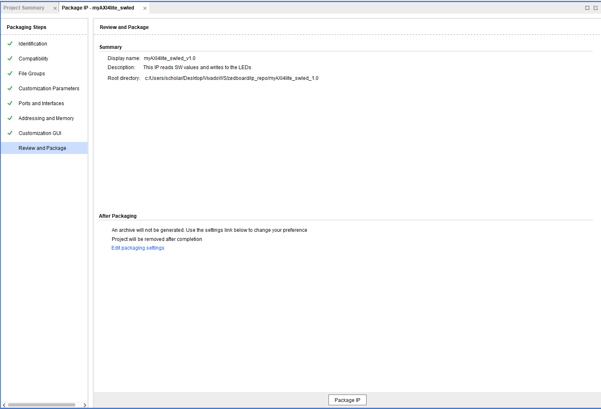

## 6. Add the IP repository to your project

In the target project (not the IP project): **Settings → IP → Repository →
add the IP folder** chosen in step 1. Vivado indexes IPs there, and the new
peripheral becomes searchable in the block design's **Add IP** dialog.

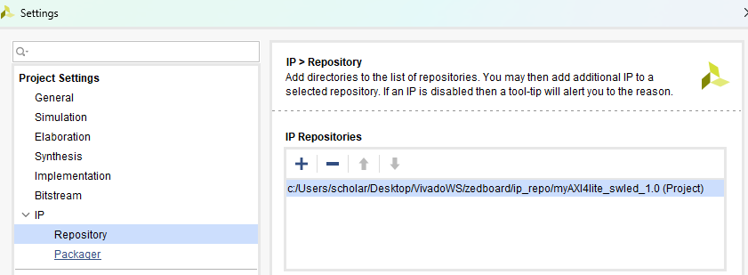

## 7. Edit the IP later (if needed)

Right-click the IP block in the block design → **Edit in IP Packager**. This
reopens the same IP project from step 3. After making changes, **Re-Package
IP** and refresh/upgrade the IP in the block design.

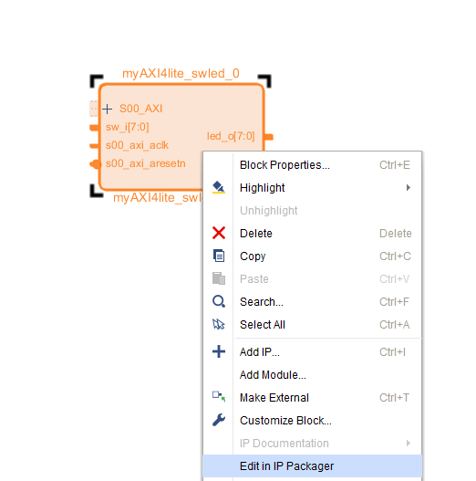

## 8. Wire up the block design

Run **Block Automation** and **Connection Automation**, then **Create HDL
Wrapper** for the block design. Add an XDC constraints file that maps the
`switches` and `led_o` ports to the physical pins for your board, matching
the I/O standard and voltage of the switches/LEDs used.

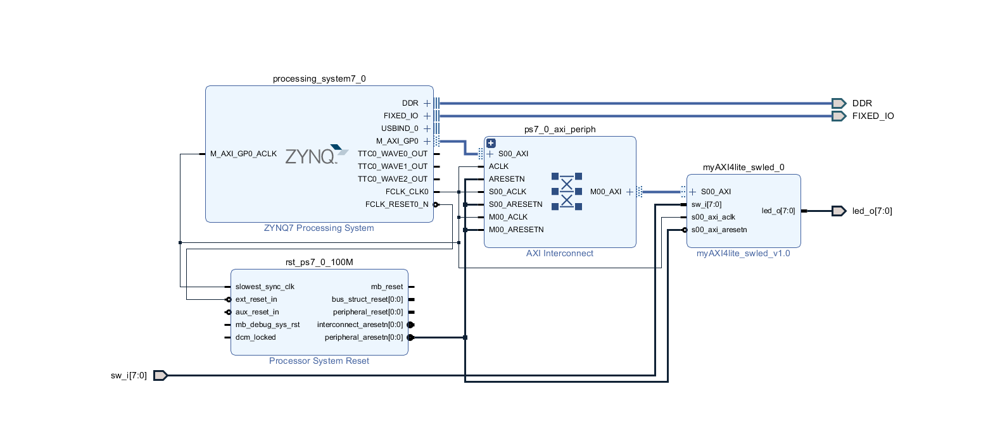

## 9. Export hardware and build the application

**File → Export Hardware → Fixed**, include the bitstream, and save the
`.xsa` file.

Launch **Vitis IDE** from Tools and create an application project against
that `.xsa`, following the same steps as the previous project in this repo.

## 10. Find the register addresses

Vitis generates a `xparameters.h` under the BSP with the base address of
every peripheral in the design:

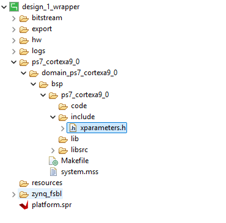

The generated address for this custom peripheral:

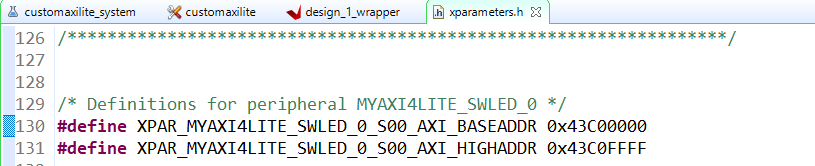

## 11. Application code

Full source: [src/helloworld.c](src/helloworld.c)

`Xil_In8` reads an 8-bit value from a memory-mapped address.
`Xil_Out8` writes an 8-bit value to a memory-mapped address.

```c
#include <stdio.h>
#include "platform.h"
#include "xparameters.h"
#include "xil_io.h"

int main()
{
    unsigned char sw_values;

    while (1) {
        sw_values = Xil_In8(XPAR_MYAXI4LITE_SWLED_0_S00_AXI_BASEADDR);
        Xil_Out8(XPAR_MYAXI4LITE_SWLED_0_S00_AXI_BASEADDR + 4, sw_values);
    }
}
```

`BASEADDR` is `reg0` (switches, offset `0x0`). `BASEADDR + 4` is `reg1`
(LEDs, offset `0x4`) — AXI4-Lite registers are word-addressed 4 bytes apart.

## 12. Verification with UVVM

Before putting the IP on the board, it can be checked in simulation. The [UVVM](../gu03_uvvm_verification_guide/README.md) AXI-Lite BFM (bus functional model) plays the **AXI master**, the custom IP is the slave:

```
 testbench (p_main)  ->  axilite_write / axilite_check  ->  BFM  ->  axilite_if record  ->  DUT s00_axi_* ports
        |                                                                                      |
        +---- sw_i (switches, driven by the testbench)         led_o (LEDs, checked on the pins) ----+
```

A BFM call such as `axilite_write(addr, data, msg)` runs a whole bus transaction: it drives the write address and data channels, waits for the slave's ready/valid handshakes, takes the write response and logs the result. The test only says *what* to write or expect.

### Register map the tests are written against

| Byte address | Register | Access     | Meaning                              |
|--------------|----------|------------|--------------------------------------|
| `0x0`        | `reg0`   | read-only  | bits 7:0 = `sw_i`, bits 31:8 = 0 (writes accepted but ignored) |
| `0x4`        | `reg1`   | read/write | bits 7:0 drive `led_o`               |
| `0x8`        | `reg2`   | read/write | plain storage, no output             |
| `0xC`        | `reg3`   | read/write | plain storage, no output             |

The register is selected by address bits 3:2, which is why the byte addresses are 4 apart (the same offsets as in the C code above).

### Two testbenches

**`tb_axilite.vhd` — smoke test.** Read `reg0` after setting the switches to `0x3C` and expect `0x3C`. Write `0x3C` to `reg1` and check `led_o` on the pins. Short, and a good first proof that the wiring and the BFM setup are right. It follows [Aykenar's AXI4-Lite verification article](https://www.mehmetburakaykenar.com/verification-of-a-custom-axi4-lite-ip-using-uvvm/184/) and is heavily commented.

Result: the run ended with no `ERROR` or `FAILURE` alerts and `Simulation SUCCESS`. The only alert was a harmless `TB_WARNING` about a truncated log timestamp, caused by a `wait for 1 ps` in the testbench.

**`tb_axilite_regs.vhd` — register-level testbench.** Tests the behavior of the register file, one test at a time:

| # | Test | What it checks |
|---|------|----------------|
| 1 | Reset values | `reg1` to `reg3` read 0 after reset, `led_o` is 0 |
| 2 | Switches | `reg0` follows `sw_i` live |
| 3 | `reg0` is read-only | a write to `0x0` is accepted but changes nothing, `reg1` and the LEDs are not disturbed |
| 4 | LEDs | patterns `A5`, `5A`, `FF`, `00` written to `reg1`, checked on `led_o` and read back |
| 5 | Independence | `reg1`, `reg2`, `reg3` written with different values and all read back (catches a wrong address decode) |
| 6 | Walking ones on `reg2` | a single `1` through all 32 bits, then `reg3` must be unchanged |
| 7 | Partial writes (`WSTRB`) | only the enabled byte lanes change, nothing changes with no byte enabled, byte 1 of `reg1` does not reach the LEDs |
| 8 | Negative test | a deliberately wrong check, registered as an expected alert: the run still ends in `SUCCESS` with 1 expected `ERROR` |

Result: all eight tests ran in ModelSim, every `axilite_check` printed `=> OK`, and the run ended with `Simulation SUCCESS`. Test 8's deliberate error shows up as one `ERROR` in the `REGARDED` column and one in `EXPECTED`:

```
# UVVM: ID_LOG_HDR   5262.5 ns  TB seq.   Test 8: deliberate failure (one expected ERROR)
# UVVM: ***  ERROR #1  ***
# UVVM:        5312.5 ns   TB seq.
# UVVM:                    axilite_check(A:x"8", x"00000000")=> Failed. Was x"11BB33DD". Expected x"00000000". 'WRONG on purpose: reg2 is 0x11BB33DD, not 0'
# UVVM:                                REGARDED   EXPECTED  IGNORED      Comment?
# UVVM:                ERROR        :      1         1         0         ok
# UVVM:      >> Simulation SUCCESS: No mismatch between counted and expected serious alerts
```

Things the run shows:

* **Partial writes work as the IP intends.** `0xAABBCCDD` written with byte lanes 0 and 2 enabled turned `0x11223344` into `0x11BB33DD`, and a write with no byte enabled changed nothing. The BFM accepted the all-zero strobe without complaint.
* **`reg0` is read-only.** The write of `0xFFFFFFFF` to `0x0` completed with an `OKAY` response, `reg0` kept showing the switches (`0x55`), and `reg1` was not disturbed.
* **Walking ones:** all 32 bits of `reg2` were stored and read back, and `reg3` kept `0xCAFEF00D` afterwards.
* **Every bus transaction takes about 50 ns** (5 clocks at 100 MHz) with this IP, one transaction after the other.
* **No `TB_WARNING`:** the timestamp warning of the smoke test is gone, since the testbench waits `1 ns` instead of `1 ps` after setting the BFM config.

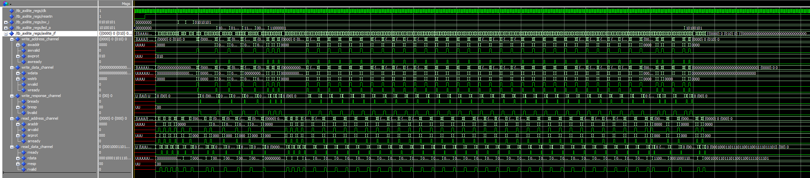

The waveform shows the whole run: `resetn` released, `sw_i` changing, `led_o` following `reg1`, and the five AXI channels of `axilite_if` with the `awvalid`/`awready`, `wvalid`/`wready`, `bvalid`/`bready` and `arvalid`/`arready`/`rvalid`/`rready` handshakes for each transaction.

The patterns in this table are explained in the [UVVM verification guide](../gu03_uvvm_verification_guide/README.md#directed-test-patterns-worth-reusing).

### AXI-Lite BFM cheat sheet

| Call | What it does |
|------|--------------|
| `axilite_write(addr, data, msg, clk, axilite_if, ...)` | full 32-bit write, all byte strobes set, expects an `OKAY` response |
| `axilite_write(addr, data, byte_enable, msg, clk, axilite_if, ...)` | partial write: one `byte_enable` bit per byte lane (`WSTRB`), bit 0 = data bits 7:0 |
| `axilite_read(addr, data_var, msg, clk, axilite_if, ...)` | read a register and return the value in a variable |
| `axilite_check(addr, data_exp, msg, clk, axilite_if, alert_level, ...)` | read a register and compare, raising an alert of that severity on a mismatch |
| `init_axilite_if_signals(addr_width, data_width)` | idle values for the interface record, call it before the first transaction |

Useful settings in `t_axilite_bfm_config` (default: `C_AXILITE_BFM_CONFIG_DEFAULT`):

| Field | Default | Meaning |
|-------|---------|---------|
| `clock_period` | undefined | set it to the real clock period before the first call |
| `max_wait_cycles` | 1000 | alert if the slave never raises ready or valid |
| `expected_response` | `OKAY` | a different response (for example `SLVERR`) raises an alert, so to test an error response on purpose, set this first |
| `protection_setting` | unprivileged, non-secure, data | value driven on `AWPROT` and `ARPROT` |

The testbenches wrap `axilite_write` and `axilite_check` in local procedures so that a test line reads `axilite_write(c_reg1_addr, x"000000A5", "message")`.

### Running it in ModelSim

1. Compile as **VHDL-2008**, in this order: `myAXI4lite_swled_v1_0_S00_AXI.vhd`, `myAXI4lite_swled_v1_0.vhd`, then the testbench. In a ModelSim *project* the testbench must be last in the compile order, otherwise the DUT is not found yet.
2. `uvvm_util` must be mapped to the compiled UVVM Light.
3. Simulate `work.tb_axilite` or `work.tb_axilite_regs`, then `run -all`. The end of the transcript is the UVVM alert summary. No `ERROR` or `FAILURE` in the `REGARDED` column and `Simulation SUCCESS` means the test passed.
4. `tb_axilite_regs` logs every bus transaction (`ID_BFM`) and a header per test, so a pass is visible in the transcript.

### Using these testbenches for another AXI-Lite IP

- Change the entity in the `DUT : entity work.<name>` line and keep the port map: the `s00_axi_*` names are the Vivado template's.
- Set `c_axi_addr_width` and `c_axi_data_width` to the IP's generics.
- Update the register addresses and the expected values to the new register map.
- The IP in this project always answers `OKAY`, so there is no error-response test. For an IP that returns `SLVERR`, set `expected_response` in the BFM config before the transaction that should fail.

## References

1. [Mehmet Burak Aykenar – GitHub](https://github.com/mbaykenar/zynq-soc-hw-sw-design)
2. [Mehmet Burak Aykenar – Verification of a custom AXI4-Lite IP using UVVM](https://www.mehmetburakaykenar.com/verification-of-a-custom-axi4-lite-ip-using-uvvm/184/)

